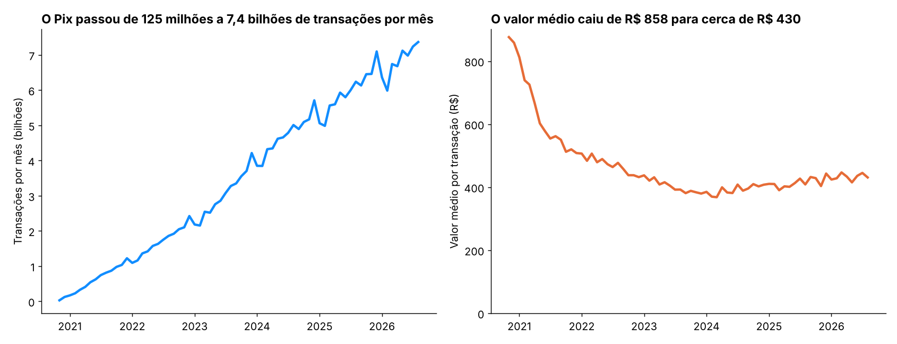

# Pix: o que mudou em quase seis anos de pagamentos instantâneos

Análise das estatísticas abertas do Pix, do Banco Central, de nov/2020 a ago/2026: crescimento, valor médio, quem paga a quem e como o pagamento é iniciado. Feito com Python (pandas, matplotlib).

## Principais resultados
- **De 125 milhões para 7,4 bilhões de transações por mês** (dez/2020 a ago/2026, 59 vezes). O valor mensal cresceu 30 vezes, então o **valor médio por transação caiu** de R$ 858 para R$ 431.
- **Pessoa para pessoa deixou de ser a maioria:** de 84,8% para 39,5% das transações. Pagar empresas (P2B) foi de 6,4% para 46,6%. Em valor, 50,9% vem de empresa para empresa, que são só 4,2% das transações.
- **O QR Code dinâmico passou a chave Pix** como forma mais usada (43,9% contra 37,8% em ago/2026).
- **Sazonalidade clara:** dezembro sobe e janeiro cai todo ano (de 9,9% a 18,3% acima de novembro e de 8,6% a 11,4% abaixo no mês seguinte).



## Fonte dos dados
API de dados abertos do Pix do Banco Central (função `EstatisticasTransacoesPix`), licença ODbL. O repositório guarda os dados já somados por dimensão em `data/`; o detalhe linha a linha (cerca de 740 mil linhas) não cabe aqui e o `scripts/coleta.py` refaz a coleta.

## Passo a passo
- [x] [01 · Pergunta e objetivo](docs/01-pergunta.md)
- [x] [02 · Dados](docs/02-dados.md)
- [x] [03 · Coleta e preparo](docs/03-coleta-e-preparo.md)
- [x] [04 · Análise e resultados](docs/04-analise.md)

## Como reproduzir
```
pip install pandas matplotlib
python scripts/analise.py
```
Isso lê os arquivos de `data/` e refaz os números e gráficos. Para refazer também a coleta (leva alguns minutos): `python scripts/coleta.py`.

## Por que este tema
O Pix é o meio de pagamento que eu mais uso e queria ver nos dados como ele se espalhou.
