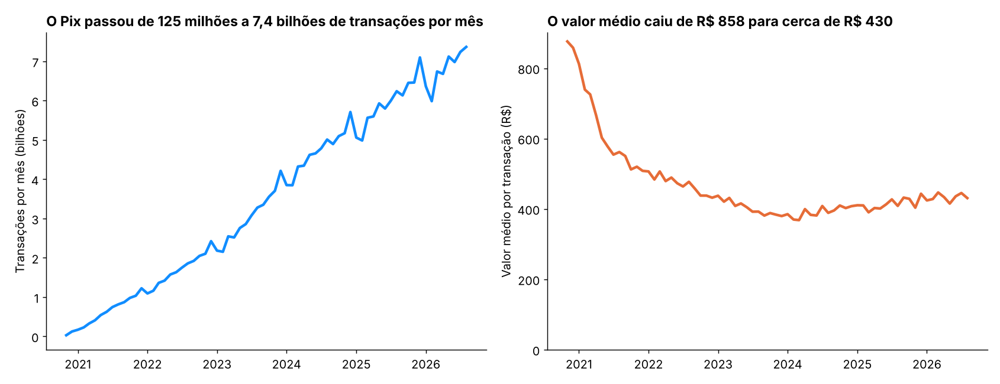
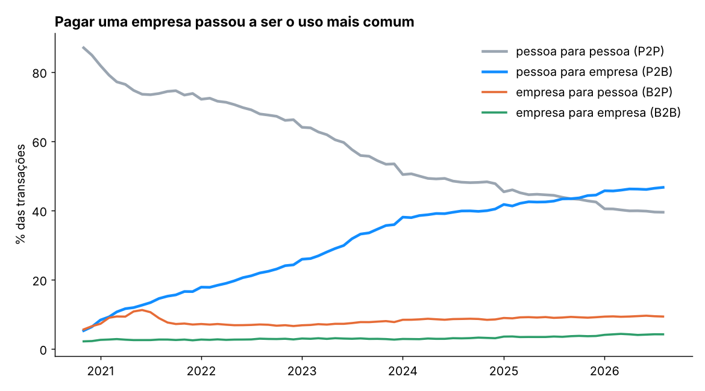
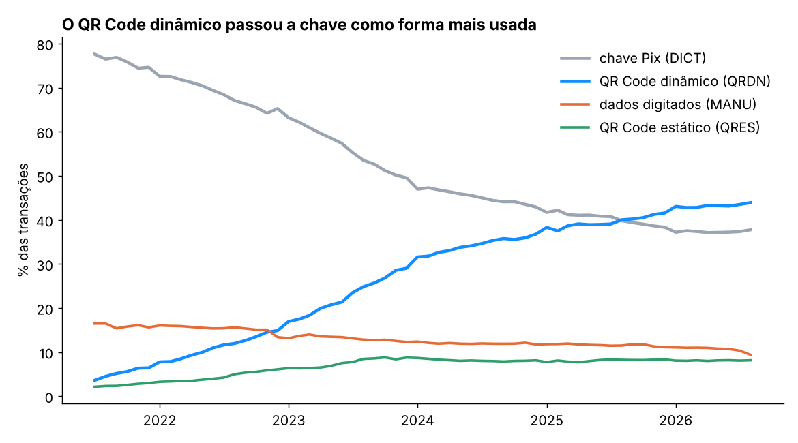

# 04 · Análise e resultados

Script: `scripts/analise.py`. Gráficos em `graficos/`.

## 1. Quanto cresceu e o valor médio
Entre dez/2020 e ago/2026 a quantidade mensal foi de 125 milhões para 7,4 bilhões de transações (59 vezes) e o valor mensal passou de R$ 107 bilhões para R$ 3,2 trilhões (30 vezes). Como a quantidade cresceu mais que o valor, o **valor médio por transação caiu**: R$ 858 em dez/2020, mínimo de R$ 368 em mar/2024, R$ 431 em ago/2026.

| Ano | Transações (bilhões) | Valor (R$ trilhões) | Valor médio (R$) |
|---|---|---|---|
| 2021 | 8,0 | 4,5 | 567 |
| 2022 | 20,3 | 9,5 | 466 |
| 2023 | 36,2 | 14,5 | 400 |
| 2024 | 56,3 | 22,1 | 393 |
| 2025 | 71,3 | 29,6 | 415 |

(2020 e 2026 não entram na comparação por serem parciais.)

## 2. Sazonalidade
Todo ano a quantidade sobe em dezembro e cai em janeiro. De 2021 a 2025, dezembro ficou entre 9,9% e 18,3% acima de novembro, e janeiro entre 8,6% e 11,4% abaixo de dezembro. O efeito de dezembro diminui ano a ano (de 18,3% para 9,9%).

## 3. Quem paga a quem
O Pix deixou de ser principalmente entre pessoas. A participação de pessoa para pessoa (P2P) caiu de 84,8% (dez/2020) para 39,5% (ago/2026), e a de pessoa para empresa (P2B) subiu de 6,4% para 46,6%. Em valor a história é outra: em ago/2026, 50,9% do valor vem de empresa para empresa (B2B), que são só 4,2% das transações.

## 4. Como o pagamento é iniciado
Em dez/2021 a chave Pix respondia por 74,6% das transações e o QR Code dinâmico por 6,4%. Em ago/2026 a chave está em 37,8% e o QR Code dinâmico em 43,9%. Os dados digitados caíram de 15,6% para 9,4%. A forma de iniciação só é informada a partir de jul/2021.

## 5. Idade e região
- **Idade (pagadores pessoa física com idade informada):** a faixa de 30 a 39 anos é a maior nos três anos comparados (33,4% em 2021, 29,2% em 2025). As faixas de 50 a 59 e de mais de 60 anos cresceram um pouco (de 9,2% para 11,8% e de 4,8% para 5,5%). A faixa "até 19 anos" salta de 0,8% (2021) para 4,7% (2023); um salto desse tamanho pode vir de mudança na coleta, então não tiro conclusão.
- **Região do pagador:** o Sudeste segue na frente, mas cai de 46,7% (2021) para 42,6% (2025), enquanto o Nordeste sobe de 22,7% para 26,9%.
- **Fluxo:** em 2025, 73,7% das transações com região informada têm pagador e recebedor na mesma região.

## Limitações
- Só estatísticas agregadas: não dá para falar de pessoas nem de comportamento individual.
- Valores não corrigidos pela inflação; o aumento em reais mistura crescimento real e preços.
- Valor médio é média simples; não representa a transação típica.
- Não testei causas (por que o QR Code cresceu, por exemplo). Leio os números, não explico o motivo.
